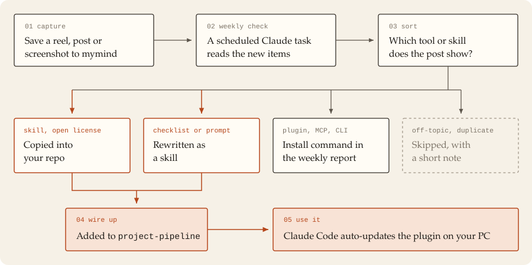

# claude-auto-kit

My own Claude Code skill kit. I save reels and posts about Claude skills to mymind; once a week a Claude task finds the tool or skill behind each one, adds the useful ones here as a pull request, and I merge what I want. Claude Code then updates the plugin on my machine.

**Want your own?** Start from [claude-auto-kit-template](https://github.com/HCvCH/claude-auto-kit-template). It has the setup guide and the weekly check prompt, and your copy fills up with your finds instead of mine. You can also copy single skills from this repo into yours; check each one's license first.

## Skills in this kit

**Written for this repo**

| Skill | For |
|---|---|
| `project-pipeline` | Orchestrator: classifies a project, runs the matching skills, offers three style directions |
| `video-pipeline` | Picks the video format and the skills to build it |
| `web-security-checklist` | Pre-launch security review for AI-built web apps |
| `claude-md-audit` | Audits and slims down CLAUDE.md files (run it yourself) |
| `design-references` | Style catalog, font pairings, libraries, poster and ad rules |
| `image-to-code` | Builds sections from reference images |
| `maps-to-website` | Local-business website from a Maps link |
| `ffmpeg-media` | ffmpeg recipes for cutting, reframing, captions and audio |
| `ai-video-prompts` | Prompts for AI video generators in seven formats |
| `sound-effects` | Free SFX via Openverse, choosing sounds and placing them on exact frames |
| `workflow-stacks` | Tool stacks and free replacements for paid tools |
| `claude-code-resources` | Map of Claude Code repos, guides and packs |

**Copied with license**

| Skill | For | Source |
|---|---|---|
| `hallmark` | Page structure, themes and audits against generic AI layouts | [nutlope/hallmark](https://github.com/nutlope/hallmark) |
| `humanizer` | Removes AI writing patterns | [blader/humanizer](https://github.com/blader/humanizer) |
| `web-design-guidelines` | UI review against Vercel's guidelines | [vercel-labs/agent-skills](https://github.com/vercel-labs/agent-skills) |
| `find-skills` | Suggests installable skills from skills.sh | [vercel-labs/skills](https://github.com/vercel-labs/skills) |
| `security-audit` | Defensive security review (validator scripts not included) | [cloudflare/security-audit-skill](https://github.com/cloudflare/security-audit-skill) |
| `i-have-adhd` | Action-first, numbered output (run it yourself) | [ayghri/i-have-adhd](https://github.com/ayghri/i-have-adhd) |
| `apple-design` | Apple-style fluid, physical motion for the web | [emilkowalski/skill](https://github.com/emilkowalski/skill) |
| `emil-design-eng` | UI polish and component details | [emilkowalski/skill](https://github.com/emilkowalski/skill) |
| `animate` | Building a single animation the right way | [emilkowalski/skill](https://github.com/emilkowalski/skill) |
| `animation-performance` | Keeping animations inside the frame budget | [emilkowalski/skill](https://github.com/emilkowalski/skill) |
| `find-animation-opportunities` | Where motion is missing, and where it isn't | [emilkowalski/skill](https://github.com/emilkowalski/skill) |
| `improve-animations` | Audit and plan for existing motion code | [emilkowalski/skill](https://github.com/emilkowalski/skill) |
| `review-animations` | Strict motion review (run it yourself) | [emilkowalski/skill](https://github.com/emilkowalski/skill) |
| `break-ui` | Stress-test UI with worst-case data | [emilkowalski/skill](https://github.com/emilkowalski/skill) |
| `pick-ui-library` | Picks a library for a frontend task (run it yourself) | [emilkowalski/skill](https://github.com/emilkowalski/skill) |

`project-pipeline` also calls tools I installed separately: the plugins `superpowers`, `ui-ux-pro-max`, `diagram-design` and the skills `design-taste-frontend`, `impeccable`, `playwright-cli`, `img2threejs`, `remotion-best-practices` and a motion graphics skill.

## License

Created by **HCvCH**. Everything written for this repo: [CC BY-NC-SA 4.0](LICENSE), non-commercial use with credit, changes under the same license. Copied skills keep their own licenses ([THIRD_PARTY_NOTICES.md](THIRD_PARTY_NOTICES.md)). [NOTICE.md](NOTICE.md) says which part falls under which.
